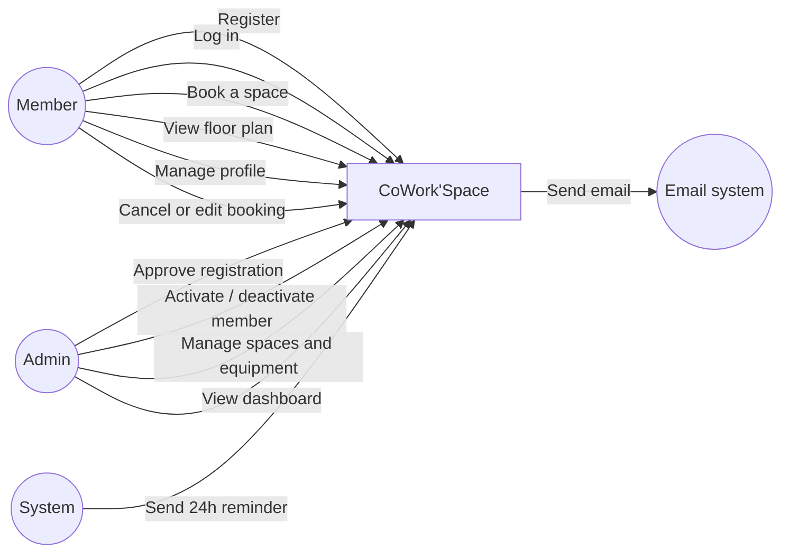
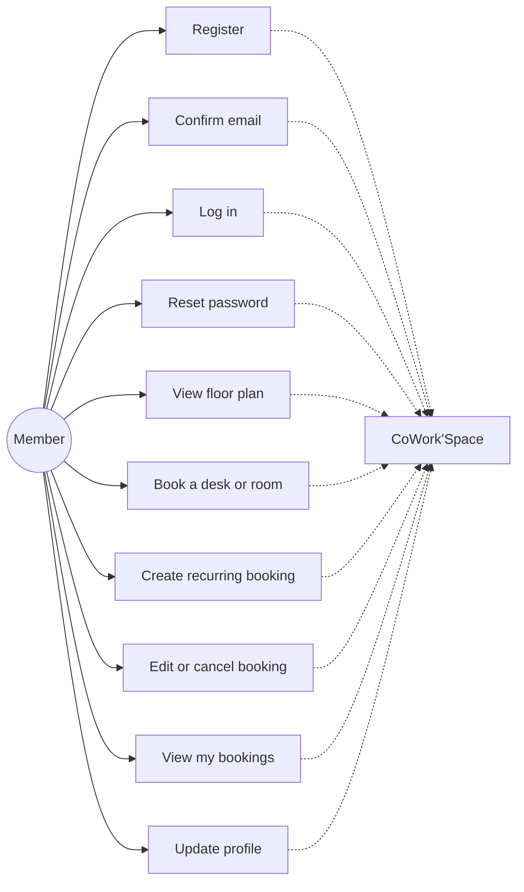
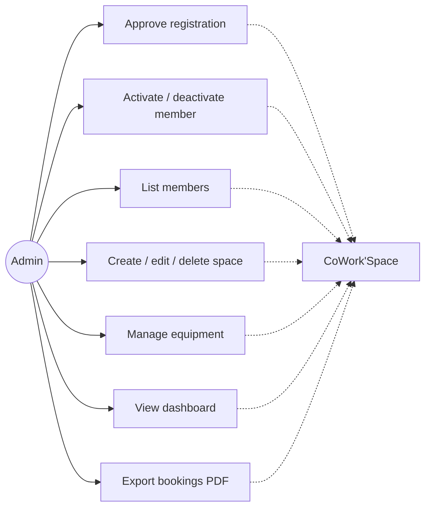
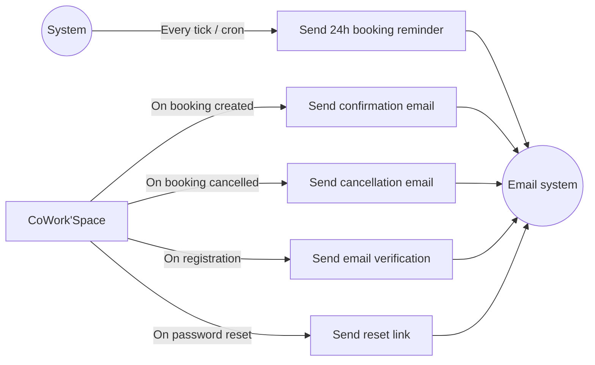

# Use cases — CoWork'Space

Business view of who does what with the system. Not technical design (no API routes, no React components).

**Actors**

| Actor (FR) | Actor (EN) | Role |
|---|---|---|
| Membre | Member | Registered user who books spaces |
| Admin | Admin | Staff who validates accounts and manages the catalog / dashboard |
| Système | System | Automated jobs (email reminders, etc.) |
| Système email | Email system | External mail delivery (Mailpit in dev) |

---

## 1. Overview

---

## 2. Member

| Use case | Goal | Preconditions | Notes |
|---|---|---|---|
| Register | Create an account | — | Often stays `pending` until admin approval |
| Confirm email | Prove email ownership | Registration started | Token link |
| Log in | Open a session | Account active | |
| Reset password | Recover access | Valid email | |
| View floor plan | See desks / rooms layout | Logged in | |
| Book a desk or room | Lock a time slot | Active member ; space exists | Conflict → error |
| Create recurring booking | Repeat a slot | Same as book | Team rule if one occurrence conflicts |
| Edit or cancel booking | Change or free a slot | Owns the booking ; within allowed window | Triggers cancellation email |
| View my bookings | See history / upcoming | Logged in | |
| Update profile | Change personal data | Logged in | Photo = optional bonus |

---

## 3. Admin

| Use case | Goal | Notes |
|---|---|---|
| Approve registration | Turn pending account into active member | Manual validation |
| Activate / deactivate member | Grant or revoke booking rights | |
| List members | Browse accounts | |
| Create / edit / delete space | Maintain desk / room catalog | Incl. capacity, type |
| Manage equipment | Attach gear to spaces | |
| View dashboard | See today’s bookings + weekly occupancy | |
| Export bookings PDF | Download a report | Bonus if time |

---

## 4. System (automated)

| Use case | Trigger | Actor |
|---|---|---|
| Send confirmation email | Booking created | System via app |
| Send cancellation email | Booking cancelled | System via app |
| Send 24h reminder | Cron (~24h before start) | System |
| Send email verification | Registration | System via app |
| Send reset link | Password reset requested | System via app |

---

## 5. Mapping to bounded contexts

| Use cases (group) | Bounded context |
|---|---|
| Register, log in, reset password, profile, approve / activate member | Identity & Access |
| Floor plan, CRUD spaces, equipment | Space Catalog |
| Book, recur, edit, cancel, my bookings, conflicts | Booking (core) |
| All email / reminder flows | Notifications |
| Dashboard, occupancy, export PDF, admin member lists (orchestration) | Operations (Pilotage) |

---

## 6. Critical scenarios (short)

### Book a space (happy path)

1. Active member chooses desk or room
2. Picks date / time slot
3. System checks conflicts
4. Booking is created
5. Confirmation email is sent

**Alt.** Slot taken → error, no booking.

### Approve registration

1. Admin opens pending members
2. Approves one account
3. Member status becomes `active`
4. Member can log in and book

---

## Out of scope (MVP)

- Payments / subscriptions  
- Multi-site coworking  
- Chat / messaging between members
